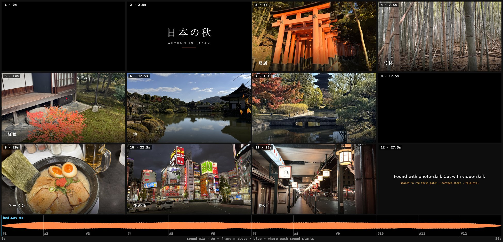
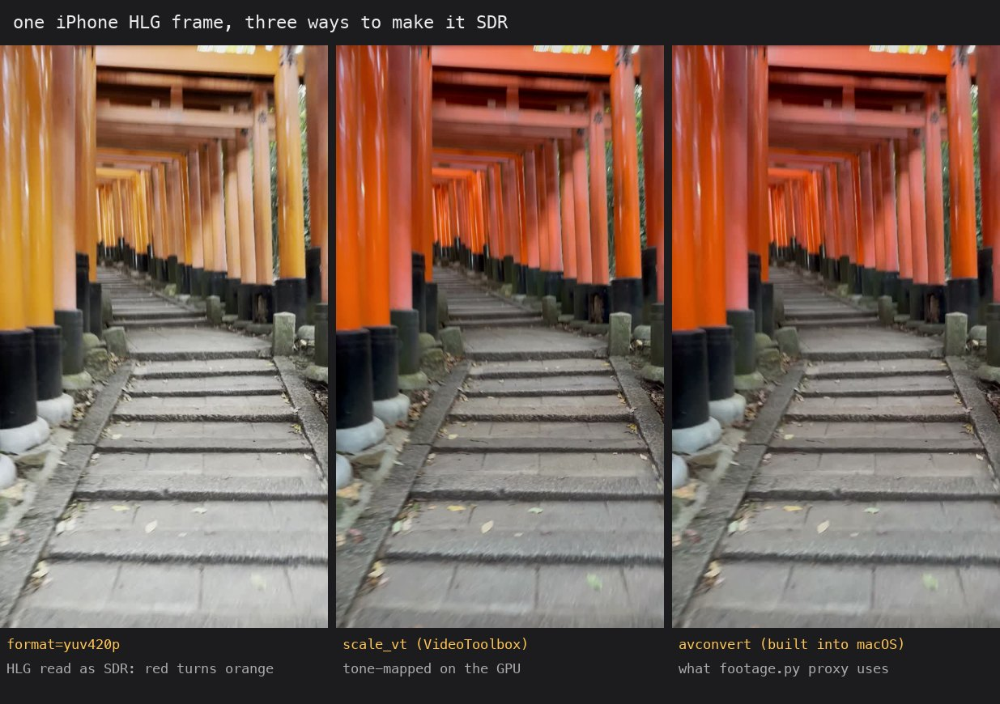
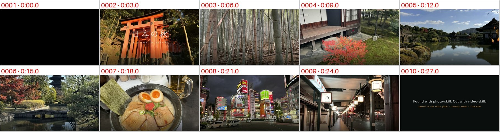
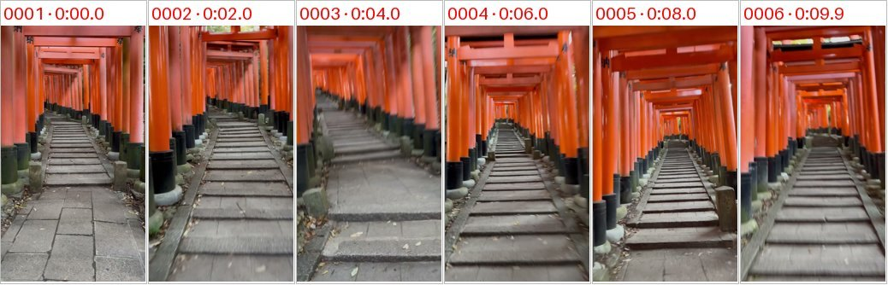

# video-skill

A [Claude Code](https://claude.com/claude-code) skill for making, checking and understanding video
from a terminal, written for an agent that **can't watch video**. Every step turns video into
something a model can read: frames to look at and numbers to check.


*From a 30-second film Claude made with this skill and its companion,
[photo-skill](https://github.com/kylefritz/photo-skill): the photos were found by searching a
library for "a red torii gate", "a bamboo forest" and so on. Watch the
whole thing: [docs/autumn-in-japan.mp4](docs/autumn-in-japan.mp4).*

## What it does

- **Makes films** with [OpenFilm](https://github.com/openfilm/openfilm) (MIT): a film is a folder
  with a `film.html` cutting together HTML pages, footage, photos and sound, where every page
  draws any moment `t` it's asked for. The skill pins the version, keeps Studio (OpenFilm's
  browser editor) out of the way, and holds the agent to a loop: write → `look` → read the
  contact sheet → fix → render → `check`.
- **Makes footage safe to work with.** `footage.py probe` flags what bites with phone video (HDR,
  rotation, variable frame rate, odd sizes), and `proxy` fixes all of it in one pass.
- **Understands footage.** `footage.py frames` pulls a frame at every scene change plus a
  regular floor, onto timestamped sheets the model reads; on-device transcription adds the audio.
- **Delivers files that play everywhere**: `check` verifies codec, pixel format, constant frame
  rate, faststart, duration and loudness; `share` makes a small copy; `gif` makes WebP or GIF loops.

## Install

```bash
git clone https://github.com/kylefritz/video-skill ~/code/video-skill
ln -s ~/code/video-skill ~/.claude/skills/video-skill
```

Then ask Claude to "set up the video skill". It runs `scripts/setup.sh`, which needs
[mise](https://mise.jdx.dev) (it installs the pinned OpenFilm and Node through it) and ffmpeg
(installed with Homebrew if missing). After that:

- "make a 30-second film from my trip photos, with a title card"
- "what happens in this clip? find the moment the train arrives"
- "this iPhone video looks washed out and sideways, fix it"
- "make a share copy small enough for Slack, and a looping preview for the README"

## The loop: `look` before you show anything



*`openfilm look` on the demo: twelve frames, each drawn twice in shuffled order to prove the
picture depends only on `t`, with the mix's waveform and loudness (-16.0 LUFS). The agent reads
this, then checks single moments at full size (`look 16.5`). That second step caught strangers'
faces in a background that were invisible at tile size, and the shot was replaced.*

## Footage: probe, proxy, then look

```text
$ footage.py probe clip.mov
clip.mov  12.54s  3840x2160  hevc  yuv420p10le  23.997 fps  arib-std-b67  audio aac 44100 Hz
  WARN HDR (HLG, bt2020): frames look washed out and miscolored unless tone-mapped; run proxy before looking
  WARN rotation -90: stored sideways; players and ffmpeg rotate it, some tools don't
  WARN variable frame rate (nominal 24.000, average 23.997): timestamps drift; proxy fixes it
$ footage.py proxy clip.mov clip.mp4
clip.mp4  12.54s  1080x1920  h264  yuv420p  30.000 fps  bt709  audio aac 48000 Hz
```

iPhones record HDR (HLG) by default. Read as ordinary video, it isn't just washed out: the colors
shift.



`proxy` tone-maps with macOS's built-in `avconvert` (ffmpeg's `zscale` is missing from Homebrew's
build), bakes the rotation in, and makes the frame rate constant. Then `frames` gives the model
something to read, labeled with ids and times it can cite:





For talk, transcribe on-device with word times (`uvx parakeet-mlx audio.wav --output-format json`)
and join words to frames by time. Proper nouns come back wrong ("torii" → "Torrey"), so the skill
checks names against the frames.

## Numbers this skill was built on

All measured on an M4 Mac mini, ffmpeg 9, OpenFilm 0.2.7.

| What | Result |
|---|---|
| Render, 30 s at 1080p30 | 17 s (hardware H.264); 34 MB → 3.8 MB as a share copy |
| HDR proxy, 12.5 s of 4K HLG | 8.6 s |
| A 5.6 s photo loop with a slow zoom, 480 px | GIF 6.7 MB, **animated WebP 1.6 MB** (GIF can't reuse pixels when every pixel moves) |
| Loudness targets | -16 LUFS integrated, true peak ≤ -1 dBTP; a bed under voice ~-22 |
| Transcription, first run | ~60 s for a short clip, mostly the model download |
| GPS in iPhone video | present in the original; gone after `proxy` or `share` (`-map_metadata -1`) |

## Alternatives

OpenFilm fits an agent best here because a film is plain HTML and `look` hands back exactly what
the agent needs to see. Also worth knowing:
[HyperFrames](https://github.com/heygen-com/hyperframes) (HeyGen, Apache-2.0, HTML + GSAP, with a
lint/layout/contrast `check` gate), [Remotion](https://www.remotion.dev) (React; larger companies
need a license), [Manim](https://www.manim.community) for math explainers, and MoviePy or plain
ffmpeg for simple cuts.

## What's in here

| File | What it does |
|---|---|
| `SKILL.md` | the instructions Claude follows |
| `scripts/openfilm` | OpenFilm pinned to one version through mise, no browser pop-ups |
| `scripts/footage.py` | `probe`, `proxy`, `frames`, `check`, `gif`, `share` |
| `scripts/check_verdicts.py` | verifies a model pass over sheets answered every tile once |
| `scripts/setup.sh` | checks mise, ffmpeg and OpenFilm; reports Playwright browsers OpenFilm removed |

Requires macOS for HDR tone-mapping (`avconvert`); everything else needs only ffmpeg, uv and mise.

## Companion: photo-skill

[**photo-skill**](https://github.com/kylefritz/photo-skill) finds the pictures: it searches an
Apple Photos library (or any folder) by date, place, person or what's in the photo, judges
candidates on contact sheets, and downloads full-resolution originals from iCloud. This skill
hands photo work to it, and it hands films back here. Install both:

```bash
git clone https://github.com/kylefritz/photo-skill ~/code/photo-skill
ln -s ~/code/photo-skill ~/.claude/skills/photo-skill
```

## Companion: music-skill

[**music-skill**](https://github.com/kylefritz/music-skill) makes and checks the sound: a house
or techno bed at an exact length, tempo, key and loudness, with stems and MIDI, plus tempo, key,
structure and loudness readouts for any audio. This skill hands music work to it, and it hands
the bed back here for the final mix check. Install it the same way:

```bash
git clone https://github.com/kylefritz/music-skill ~/code/music-skill
ln -s ~/code/music-skill ~/.claude/skills/music-skill
```

## License

MIT. See [LICENSE](LICENSE). OpenFilm is a separate project under its own MIT license.
